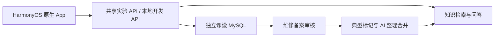

# 开发方案

根据项目组提供的《鸿蒙电脑医院课设_开发方案与Issue拆分基线.md》（2026-09-28）保留功能主线。原有细粒度 Issues 已取消；按用户 2026-10-09 的决定，使用 [根 README 的模块 Issue](../README.md#模块任务) 记录目标、依赖、必要验收和进度，团队自行认领和安排，不采用固定周计划或成员审批。2026-10-12 新增 Web 功能迁移四模块 #60–#63，范围见下文。按用户 2026-10-11 的决定，修改必须通过 PR，以普通 Merge 合入 `main`，解决审查讨论但不要求另一位成员批准；禁止直接推送、强推和删除主分支。课设数据库直接运行，不使用 Docker；App 开发默认使用共享实验后端，接口开发保留本地环境。

## 目标与范围

做一款 HarmonyOS 原生手机应用，以电脑医院维修服务为场景，界面主要参考“我的华为”的服务板块。课程演示应能完成客户与工作人员之间的真实业务链，并展示有出处的 AI 问答和维修案例回流。

| 模块 | 要实现的能力 |
| --- | --- |
| 登录与个人页 | 登录、恢复会话、退出、显示角色、处理会话过期 |
| 客户服务 | 服务首页、设备和故障描述、报修提交、我的报修列表与详情、进度时间线 |
| 工作人员 | 待处理列表、详情、受理与状态更新、维修备案草稿和提交 |
| 知识问答 | 查询资料、AI 回答或追问、证据不足提示、可打开的来源引用 |
| 辅助建单 | AI 生成可编辑报修草稿，由客户检查后手动提交 |
| 案例回流 | 已审核备案标记典型，AI 自动整理、去重/相似合并并发布入检索 |

活动内容与个人页入口按下文页面映射推进，活动报名是否接通按实际接口验收。语音、卡片、平板适配等由团队根据时间选做。页面处理加载、空数据和失败状态；占位页不计作已完成功能。

## 业务链

1. 客户描述设备故障，可先咨询 AI。
2. 客户检查并提交报修；工作人员看到新单。
3. 工作人员受理、更新状态，客户刷新后看到真实变化。
4. 工作人员完成维修，填写备案并提交审核。
5. 维修备案通过审核后，作者或审核人员标记典型，AI 自动整理、去重或相似合并并发布案例。
6. 发布案例后，用另一种问法检索并打开原始依据。

客户只访问本人单据及公开知识；工作人员按服务端权限访问业务和内部资料。报修处理状态和维修备案审核状态分别维护。

## 已核实的业务基础

原 Web 核查起点是提交 `64eb141ec21468c46f001dbe7cdab1183e4cb23c`；课设后端由这份已提交源码开始，现放在本仓库 `backend/`。

- 技术栈为 Next.js App Router、TypeScript、Prisma、MySQL 协议数据库；原服务使用 GreatSQL，本课设改用本机 MySQL。
- 原 Web 会话通过 HttpOnly Cookie 读取 Session，写请求检查 Origin；课设现已实现原生 Bearer 登录/会话及部分业务写入，但其余 Web 写路由仍需按模块适配，不能因 GET 可用就假定写入可用。
- API 使用成功/失败信封：`success`、`data` 或 `error`、`meta`，列表可能含分页信息。
- `RepairRecord` 属于工作人员成员档案，包含日期、分类、机型、内容、结果、照片、审核及时间线。审核状态为 `DRAFT → PENDING → APPROVED / REJECTED`，退回可重提。
- 原代码没有通用客户报修单。维修活动报名在接待时可生成 `RepairRecord`，这是活动流程。
- seed 提供角色、分类和技能字典；持久测试账号和维修业务数据需要单独准备。

实现一般报修时，新增客户报修对象，并明确它和维修备案的可选关联。`RepairRecord` 审核状态不代表客户维修进度。

## Web 功能迁移与客户扩展（2026-10-12 确认）

本轮将 Web 已实现的成员与管理员功能接入原生 App，并补客户个人功能和账号报名关系。Web 固定参照提交为 `e78d057e5bad64c7a73d89f4bad425473156f625`；源码已有不代表 App 功能已完成。**不迁移原 Web 数据库数据**，只选择性复用代码、业务规则与所需结构，不接生产库、不导入真实人员/维修/报名；保留已有课设数据。

| 模块 Issue | 交付范围 |
| --- | --- |
| [08 公共接口与账号 #60](https://github.com/Xiaoyuan-114/zafu-pchospital-harmonyos/issues/60) | 客户自主注册、邀请码工作人员注册、原生写请求分流、改密/强制改密、保持登录及公共契约 |
| [09 个人中心与备案 #61](https://github.com/Xiaoyuan-114/zafu-pchospital-harmonyos/issues/61) | 客户资料、指南/公开 AI 案例收藏、报修站内消息；成员资料/技能/通知/收藏、工作摘要、独立备案/评论、已审核备案案例库 |
| [10 活动闭环 #62](https://github.com/Xiaoyuan-114/zafu-pchospital-harmonyos/issues/62) | 登录后报名并绑定账号、我的报名、旧匿名查询、成员出勤/签到/接待/撤销、活动管理 |
| [11 统计与管理 #63](https://github.com/Xiaoyuan-114/zafu-pchospital-harmonyos/issues/63) | 统计/榜单、管理导航与成员/客户账号/邀请/招新/备案/字典/评论/审计/设置、导出、关于/手册、维护工具 |

全部解释、代码起点、验收和开工提示词见 [公共基线与四份任务书](tasks/web-migration/README.md)。#60 先提供必要契约；其余模块可提前盘点/准备页面，契约可用后接入，不设固定排期、不预先分配负责人，允许分批 PR。

已确认规则：

- 自主注册只能产生客户身份，不创建成员档案；有效邀请码用于工作人员，权限由服务器决定。客户资料先支持昵称/联系电话和默认头像，编辑不改写历史联系快照。
- 客户收藏指南和有效公开 AI 案例，成员保留备案收藏；来源失效/撤回/转内部后不可访问旧材料。Web 已审核备案库与 AI KnowledgeCase 分开显示来源。
- 客户报修受理/进度/完成/取消产生本人站内消息，支持已读/全部已读/删除与跳转；成员沿用 Web 通知，不做系统推送。
- 游客可浏览活动，App 报名先登录、新报名绑定当前账号；旧匿名报名继续手机号查询，不自动认领。账号报名和成员出勤分开，活动接待生成 RepairRecord 而非强行创建 RepairOrder。
- 保留当前五栏/角色导航与 #40 自动整理合并、权限、撤回和证据失效规则；不整包覆盖 backend/schema。管理功能放管理子页。
- 历史导入只保留工具并用合成样本验证，不执行原数据库数据迁移。短信找回、头像上传、公告 CMS、预约时段、设备绑定等不属于本轮新增能力。

本节是确定的待开发范围。下文 UI 改造和原业务的历史验证记录仍按当时实际结果保留，不等同四模块已完成。

## App、共享后端与本地开发

2026-10-11 工作人员流程确认：采用公共待受理队列，受理人负责后续处理，管理员可管理报修；允许先完成报修再补备案，两套状态独立。备案沿用原 Web 的本人草稿/退回编辑规则，本轮同时实现 App 内业务备案审核；典型案例自动整理与发布属于 #40。具体实现与必要验收见 [Issue #38 任务书](tasks/issue-38-staff-repair-records.md)。该任务书不代表功能已实现。

- 原生工程位于 `app/`，后端位于 `backend/`。`app/entry/src/main/ets/core/auth` 管会话，`core/network` 管请求和错误，`core/ui` 管导航与主题；业务模块位于 `features/`。
- App 默认访问 https://harmony-api.pczafu.cn；共享实验库与本地开发/测试库分离，数据库只供后端访问。服务器不执行项目构建或清库测试；本机 WSL/Linux 生成部署产物，细节见 [共享后端部署](../backend/docs/shared-deployment.md)。
- 游客直接进入首页，可浏览服务介绍与公开维修指南；报修、进度、AI 问诊及「我的」触发登录。登录后续接原操作；取消返回原页，退出回游客首页。已有会话仍向服务器验证，失效或网络无法确认时不给予已登录权限。
- 游客可读公开文档快照和活动列表/详情；内部案例、维修单据及模型调用仍保持鉴权。#62 已接通登录后的账号报名及本人查询，实际范围与限制见下方当前状态。
- 页面只接真实存在的接口，新增模型与接口先确定字段、角色、状态及错误行为。
- 原生登录需要服务端验证的会话契约；不通过伪造 Origin 绕过原 Web 保护。
- 手机调试使用电脑局域网地址；电脑后端健康检查、App 构建和真机联调分别验证。

## AI 与知识资料

2026-10-11 确认：Issue #39 本轮采用社团文档快照、中文关键词与向量混合检索、DeepSeek `deepseek-flash` 问答、原生引用详情；只保留本次多轮会话，暂不联网搜索或持久化聊天。Embedding 由本机配置的硅基流动 `BAAI/bge-m3` 提供（Key 只放后端本地环境）。报修草稿提交与状态查询待 #37 稳定后对接，案例审核回流属于 #40。具体交付与验收见 [Issue #39 任务书](tasks/issue-39-knowledge-ai.md)，本轮交付不自动关闭整个 #39。

先用项目可用的手册或指南建立基础检索，保留章节、版本和引用位置；再加入审核后的维修案例。原记录未写出的根因、机型或结果保持未知。

2026-10-11 #40 最终范围确认：仅已审核通过备案由作者或审核人员标记典型，AI 自动整理、完全重复去重及相似案例合并，保留多来源证据后直接发布，不再设置案例二次人工审核。新案例默认内部，管理员可改公开或撤回；标记取消、来源删改会使旧案例暂停检索并基于剩余来源重整。复用现有模型、检索和本地 MySQL。完整要求见 [Issue #40 任务书](tasks/issue-40-typical-case-feedback.md)，此处仅记录决定，功能尚待实现。

问答流程：问题及角色 → 检索 → 权限过滤 → 回答/追问 → 检查引用 → 展示来源。无命中时说明证据不足，可引导报修；不能为演示问题硬编码回答。AI 建单只生成草稿，提交和维修状态变更由人确认。

案例保留来源记录、证据、处理状态和可见范围；自动处理成功后进入相应索引，客户只访问有效公开案例，内部、失效或撤回案例不向客户提供。索引更新在后端执行，支持新增、合并和来源变更后重新检索。

评测由团队自行选择代表性的问题，覆盖有依据回答、换一种问法、信息不足、无命中、权限错误和草稿字段。报告真实结果及典型失败，不预设完成日期。

## 页面映射与交互要求

2026-10-15，第 13 模块 [#76](https://github.com/Xiaoyuan-114/zafu-pchospital-harmonyos/issues/76)：[全部圈子](reference/my-huawei/community-circles-category-list.jpg) → 全部维修指南左右分类目录，[社区搜索](reference/my-huawei/search-community-results.jpg) → 知识搜索结果。保留知识主页面的 AI 主按钮和折叠分类；全部指南进入目录，搜索图标进入独立结果页。指南按完整快照标题本地匹配，分类仍为标题粗分；案例通过最小鉴权接口搜索完整有效可见集合，过滤后分页，不把最近一页冒充全库。客户/工作人员继续打开 #75 对应详情，原始备案不混成 AI 案例。实际实现、截图、检查及未部署共享后端的范围见 [验证记录](verification/issue-76.md)。

2026-10-15，第 12 模块 [#75](https://github.com/Xiaoyuan-114/zafu-pchospital-harmonyos/issues/75) 实施：以 [权益查询](reference/my-huawei/service-device-benefits.jpg) 还原客户/工作人员报修详情，以 [升级指南](reference/my-huawei/harmonyos-upgrade-guide.jpg) 还原维修指南阅读，以 [帖子详情](reference/my-huawei/community-event-post-detail.jpg) 还原案例阅读，以 [圈子信息流](reference/my-huawei/community-circle-detail-feed.jpg) 还原公开/工作人员案例库。保留真实状态、服务端权限、来源版本、章节定位、收藏和已有操作，设备/计数/正文只取实际接口。已构建并在模拟器操作，截图与未验证项见 [Issue #75 验证记录](verification/issue-75.md)，最终视觉效果待维护者确认。后续 #76 处理指南目录/知识搜索，#77 处理活动详情/报名，本轮未扩展这两批布局。

2026-10-14 实施补充：维护者已确认实施下列三个子页面映射。个人资料改为账号面板，报修列表改为状态筛选/说明条/空态布局，知识页改为故障分类折叠卡与 AI 问诊入口。已构建并在模拟器操作，具体范围、截图和未验证项见 [本轮验证记录](verification/three-reference-pages-20261014.md)；其他主页面、五栏导航和角色权限保持现有规则。

2026-10-14 补充：PR #70 新增的 11 张子页面截图已按内容命名，见 [完整图片索引与三个推荐映射](reference/my-huawei/README.md#三个优先推荐映射)。优先建议账号资料面板 → 我的/个人资料、订单空态 → 报修列表、检测与帮助 → 知识分类与 AI 问诊入口；这些是后续视觉改造建议，功能仍使用现有真实接口与权限。原五个主页面及双角色导航基线继续如下。

以下为维护者 2026-10-12 确认的统一设计基线，与 [根 README 页面映射](../README.md#页面映射与参考图)一致。各页先查看对应图片，再替换成电脑医院的真实业务；参考图没有覆盖报修表单、记录详情与进度详情，这些流程仍按实际接口与业务规则设计。

| 截图 | 我的华为页面 / 参考图片 | 电脑医院页面 | 开发时按此改造 |
| --- | --- | --- | --- |
| ① | [首页](reference/my-huawei/home-navigation.jpg) | **首页** | 保留大标题、搜索框、主视觉卡片和快捷服务布局。主卡文案为「电脑出问题？先问诊或预约维修」；快捷入口为 **AI 问诊、我要报修、进度查询、近期活动** |
| ② | [我的](reference/my-huawei/my-account-service-record-entry.jpg) | **我的** | 保留头像信息卡和「我的信息」宫格，内容为 **我的报修、维修记录、活动报名、收藏、消息、个人资料**；工作人员账号提供 **进入工作台** 入口 |
| ③ | [选购](reference/my-huawei/shopping-category-navigation.jpg) | **知识（知识库）** | 保留搜索框、横幅和分类宫格的组织方式；分类改为 **开机故障、系统软件、网络、磁盘、散热等**，下方展示维修指南及已审核备案形成的有效案例；不实现购物 |
| ④ | [服务](reference/my-huawei/service-my-products-repair-entry.jpg) | **服务 / 工作台** | **最重要的仿照页面。** 客户侧「我的产品」改为 **当前报修设备／我的电脑**；「检测与帮助」对应 **AI 故障问诊**，「维修服务」对应 **预约报修**，「服务进度」对应 **报修进度**；工作人员侧组织为工作台 |
| ⑤ | [花粉](reference/my-huawei/community-huafen-feed.jpg) | **活动** | 保留顶部分类、活动横幅和信息流，内容为 **社团维修活动、服务公告、维修经验分享**；首版由社团发布，不实现人人发帖的社区 |

### 双角色导航与权限

- **客户： 首页｜活动｜服务｜知识｜我的**。「服务」是报修主入口，「我的」查看本人记录；知识只展示客户有权访问的指南与公开案例。
- **工作人员： 首页｜活动｜工作台｜知识｜我的**。保持相近外观，中间「服务」改为「工作台」，组织待处理报修、处理中、维修备案及审核相关入口；「我的」也提供进入工作台入口，知识可展示其有权查看的内部案例。
- 工作台中的「待审核案例」按现有业务口径衔接**维修备案审核**：审核入口只向服务端授权的人员展示，不因工作人员身份就授予审核权限。已审核备案被标记典型后仍按 #40 自动整理、合并并发布，**不新增典型案例二次审核**。
- 导航名称统一为「知识」，页面内容可以称知识库；截图③选购 → 知识、截图⑤花粉 → 活动，图片编号不是底部导航顺序。

### 按页实现要点

- **首页**：保持参考图的大标题、搜索、金色主视觉、快捷服务和悬浮导航层级。搜索/AI 问诊、报修与进度入口连接真实业务；静态插画不代表设备诊断或维修结果。底部胶囊导航对照原图的液态玻璃质感，包括透光、背景模糊、蓝白反光与边缘高光。
- **我的**：头像信息卡展示当前会话身份；我的报修、维修记录只显示本人有权查看的记录。维修备案与客户报修是不同对象，不能只改标题当成同一数据列表。六个目标入口中尚无接口的功能如实标明未接入；工作人员的进入工作台入口与底部工作台指向同一业务视角。
- **知识**：故障分类用于查找指南与有效案例，保留来源与可见范围。客户只能访问公开内容；工作人员也按服务器权限查看内部内容，不把内部案例或原始备案照片直接开放给客户。知识首页与 AI 问答是不同层级，现有问答页不能代替分类知识首页的完成状态。
- **服务 / 工作台**：客户以当前报修设备／我的电脑为上下文，连接 AI 故障问诊、报修和进度；工作人员围绕待处理报修、本人处理中单据、维修备案与有权限的审核工作组织页面。现有本人编辑、受理人处理和管理员管理规则保持；不能用改导航标签代替工作台业务实现。
- **活动**：首版以社团发布内容为来源，组织维修活动、公告和经验分享；不建设人人发帖的社交系统。活动列表、详情、报名分别按团队实际范围实现，不能将静态活动卡片算作已接通报名。

### 设计目标与已实现范围

2026-10-12：五个独立主页面已按对应参考图完成布局改造，底栏点击与左右手势使用原生横向滑动，液态玻璃底栏保持悬浮。服务/工作台、我的复用已有业务；知识新增公开指南分类浏览，工作人员可查看授权案例；活动读取真实维修活动接口。

2026-10-12 当轮范围经维护者确认：只改造四个主页面与导航，已有功能连接真实接口；当时活动报名、收藏、消息、个人资料编辑未接入，后续由 #61/#62 接入。服务公告、经验分享、客户原始维修备案记录仍未接入。知识分类按公开指南标题粗分，内部案例目录仍只开放给有 `repair:read` 的工作人员；客户通过 AI 问答引用查看公开案例，当轮未新增客户/游客案例列表接口。

五栏顺序固定为首页、活动、服务/工作台、知识、我的；切换时长 260ms，支持系统减少动态效果设置（关闭切换动画和横向手势，保留底栏点击）。游客点击或滑动进入「我的」均触发登录，取消留在原页。AI 问答仍是独立子页，离开后销毁本次对话。

预约时段仍是后续能力。本轮按维护者确认，服务入口实际显示「我要报修」并复用已有报修流程，不把当前接口标成已实现预约。设备卡目前由本人报修记录派生，不代表已有独立设备绑定功能。入口未接入时明确提示，不能用假数据或仅能点击的占位页宣称完成。

本轮四页实现及模拟器检查见 [四页验证记录](verification/four-reference-pages-20261012.md)，图片来源与实现差异见 [参考图索引](reference/my-huawei/README.md)。报修表单、审核详情、AI 对话等业务子页沿用现有实现。

## 课程演示

最终演示包括：客户登录与咨询、引用打开、人工确认报修、工作人员处理、客户查看变化、维修备案审核、标记典型后自动整理合并入库、再次检索与打开多来源证据。再展示一个无依据或无权访问的失败场景。界面截图、设备信息、应用包和四人贡献按实际完成情况记录。

## 当前状态

2026-10-15 #62 收尾：取消本人未处理出勤、成功业务永久标记及旧审计兼容、取消/现场事务互斥已实现；管理员失败按原动作/目标/快照重试，成功写后仅重读。529 项单测、54 项相关 DB 回归、lint、后端/HAP 构建通过，本轮系统选图和最终包验收见 [收尾记录](verification/issue-62-completion.md)。此前取消缺口安排以新规则取代，未部署共享后端，PR/Issue 合入关闭交技术主线。

首轮历史（2026-10-15）#62 功能分支：客户账号报名/本人分页及修改、匿名兼容、地点/条款、成员签到队列/电话/真实接待草稿、管理员活动和报名管理均已接入。521 项单测、44 项相关数据库回归、lint、后端生产构建及 HAP 构建通过，模拟器完成登录/注册/改密续接、双客户隔离、成员接待至待审核、管理员操作及网络重试。照片通过真实 API 上传后在 App 展示与提交，系统选图上传和实体手机未验证；取消成员出勤按用户确认保留契约缺口，未部署共享后端，#62 仍需保留打开。见 [活动验证](verification/issue-62-activities.md) 和 [接口/#63 交接](../backend/docs/native-activities-api.md)。#60/#61 前置 PR 已合并，后续历史记录按各日期理解。

2026-10-12 补充：共享后端部署与游客入口修改的实际结果以 [本轮验证](verification/shared-backend-guest-login-20261012.md)为准。下方 2026-10-11 的无设备、本地配置及检查记录为当时结果，不覆盖本轮模拟器/共享服务器验证，也不代表完整业务真机验收完成。

2026-10-11 #42 完整联调与课程演示：演示环境（开发库与测试库已应用 #40 迁移 `20261011130000_p2_issue40_knowledge_cases`、`db:health` 通过）、三个演示账号（客户 `100001`、工作人员 `100002`、纯管理员 `100003`）、设备之外的完整业务主链（55 次 HTTP 请求无一 5xx，含失败场景 12 项）、后端检查（lint exit 0、单测 441/441、数据库集成测试 197/197、生产构建 exit 0）与未签名 HAP 构建（`BUILD SUCCESSFUL`，1 197 149 字节）均已实测就绪，证据见 [Issue #42 验证记录](verification/issue-42.md)。**设备装机验收（本机 `hdc list targets` 为 `[Empty]`，模拟器无系统镜像、无签名材料，构建成功不等于装机运行正确）与模型链路（阶段2b，本机 `backend/.env` 无 `AI_API_KEY` / `EMBEDDING_API_KEY`）仍待补**；演示截图/录像、设备型号与系统版本、四人贡献说明同待补。以上均为如实记录，Issue #42 尚未关闭。

App 已接入登录与会话：登录页（可配置 API 地址、显示后端连通状态）、启动时向服务器验证并恢复会话、退出、按服务端返回的角色进入客户服务或工作人员入口；客户报修（#37）、工作人员处理、维修备案、App 内备案审核（#38）与典型案例库（#40，工作人员入口；备案页/审核页可标记典型并查看真实整理状态）已接入真实接口。后端提供原生 Bearer 会话通道（`/api/v1/auth/native/*`，[接口说明](../backend/docs/native-client-api.md)）、工作人员处理/备案接口（[说明](../backend/docs/native-repairs-api.md)）与典型案例/知识回流接口（[说明](../backend/docs/knowledge-cases-api.md)）并保留 Web Cookie 登录；测试账号用 `corepack pnpm accounts:prepare` 准备（只操作课设库）。后端已改为本机直接运行：当前电脑 MySQL 使用独立实例 `127.0.0.1:3308`，API 使用 `http://localhost:13080`；迁移、seed、健康检查、lint、生产构建、424 项单测与 193 项集成测试已通过；#38 的真实 API 链路（建单→受理→完成→建档→照片→提交→退回→重提→通过）与 #40 的真实模型链路（真实审核备案→标记典型→整理/合并→换措辞命中案例引用并打开）在开发库通过，未签名 HAP 构建成功。前后端位于同一公开仓库的 `app/` 与 `backend/`；启动步骤见 [本地开发说明](../backend/docs/local-development.md)。**真机登录链路与跨角色业务、App 内页面交互尚未验证**（无设备，构建成功不等于装机成功）；#38、#40 的未验证项分别见 [验证记录](verification/issue-38.md) 与 [验证记录](verification/issue-40.md)。每次实现后同步更新真实进度即可。
